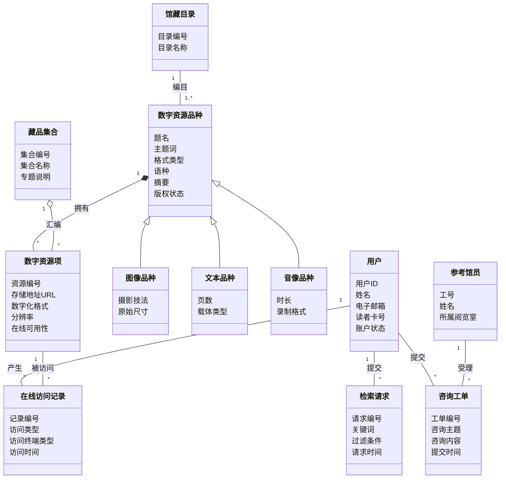
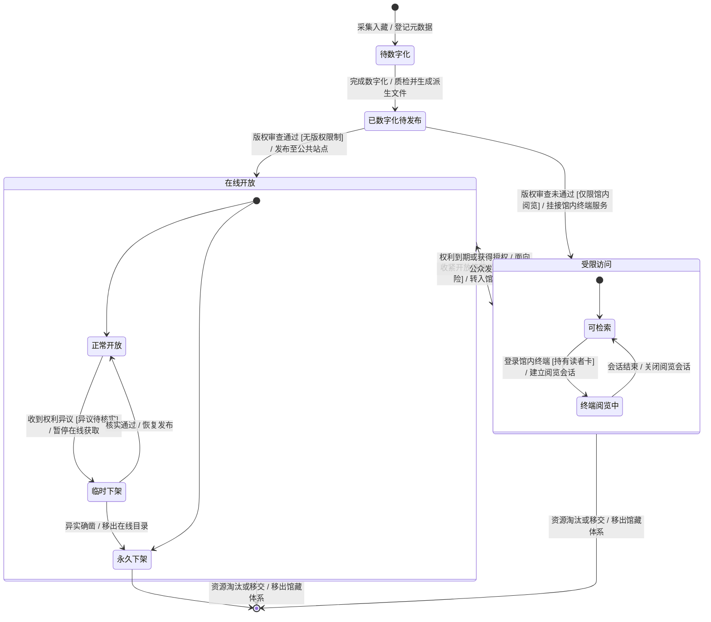
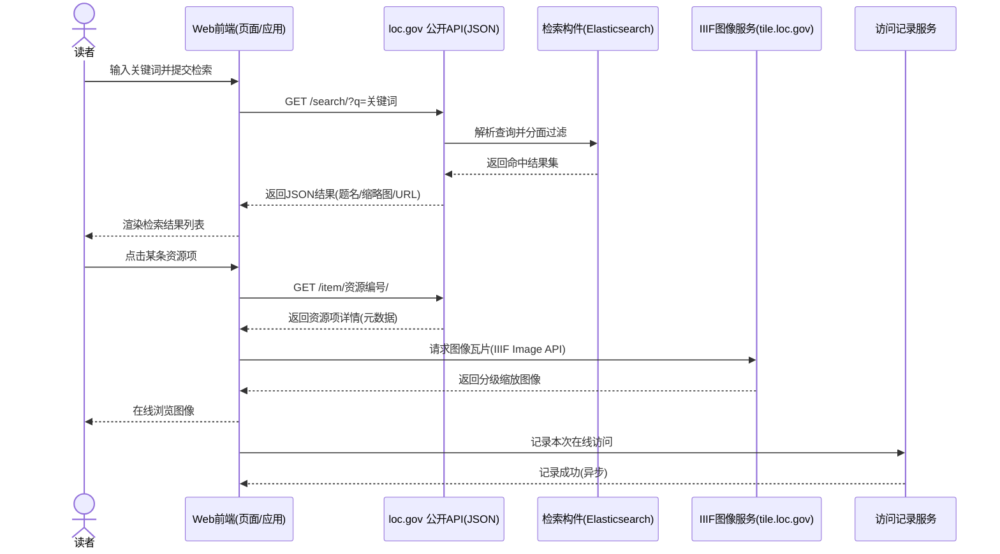
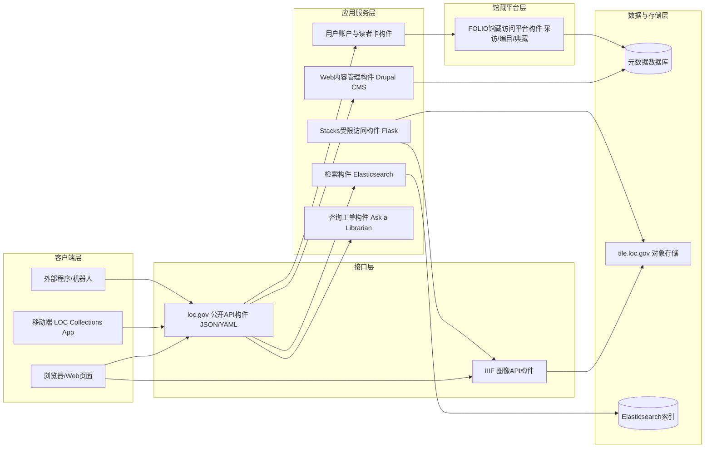

# 美国国会图书馆网站（loc.gov）分析作业

> 对照课程内容：领域对象建模（类图、状态图、交互图）、系统应用架构设计、接口层设计中的原则、要求及案例内容，分析美国国会图书馆网站的**状态图、交互图、类图、构件图**及其**软件架构体系和设计模式**。

---

## 一、网站概况与功能边界

美国国会图书馆（Library of Congress，loc.gov）是世界上最大的图书馆，其网站是面向公众、研究人员与国会议员的馆藏在线服务门户。核心业务功能包括：

1. **馆藏检索**：全站统一检索数字馆藏与实体馆藏（支持按格式、语言、主题等分面动态过滤）；
2. **数字馆藏在线浏览**：图像、文本、音像、地图等数字化资源的在线查看（基于 IIIF 图像服务）；
3. **受限资源馆内访问**：版权受限内容仅可在馆内阅读室终端访问（Stacks 系统，不可下载导出）；
4. **读者服务**：读者卡在线预注册、"Ask a Librarian" 在线咨询、活动与展览信息、参观规划；
5. **开放数据服务**：公开的 JSON/YAML API 供外部程序访问馆藏数据。

> 说明：2025 年国会图书馆上线了基于开源平台 **FOLIO** 的新一代"馆藏访问平台"（Library Collections Access Platform）与新的公共目录，采用现代化基础设施支撑检索、分面过滤与账户功能。受限访问系统 **Stacks** 是 Python/Flask/Elasticsearch 应用。本作业以此真实系统为背景，按照教材第 4 章"图书馆系统领域类图""状态图举例"的案例风格建模。

---

## 二、类图（领域对象建模）

### 2.1 绘制原则的对照验证

按照教材"绘制领域类图的注意事项"逐条自查：

| 原则 | 在本模型中的落实 |
|---|---|
| 系统中只有一个实例的对象暂不建模 | 不建模"国会图书馆"对象本身（全系统唯一），以"馆藏目录"代表目录职能 |
| 关联须能用存在量词验证 | "某些数字资源项被包含在某些藏品集合中"✓；不建"每位用户浏览所有资源项"这类全称量词关联 |
| 属性是实体与生俱来的特性 | "数字资源项"的属性不含用户姓名、访问次数等他对象属性；用户浏览行为单独建"在线访问记录"类 |
| 泛化能通过 "is a kind of" 验证 | 图像品种 is a kind of 数字资源品种 ✓ |
| 关联不出现回路 | 用户—检索请求、用户—访问记录、资源项—访问记录构成树状结构，无冗余回路 |

### 2.2 领域类图

### 2.3 关系说明

- **组成（实心菱形）**：品种与资源项是"紧密依赖的整体—部分"关系，品种端多重性为 1——某一项脱离品种即失去编目意义；
- **聚合（空心菱形）**：藏品集合只是把若干资源项"汇编"在一起做专题展示，资源项可同时属于或不属于集合，部分可独立存在；
- **泛化（三角）**：图像/文本/音像品种按 "is a kind of" 验证通过，各自追加与生俱来的属性（如音像品种的"时长"）；
- **普通关联**：用户与检索请求、访问记录之间用存在量词"某些请求由某些用户提交"验证通过。

---

## 三、状态图（数字资源项的生命周期）

### 3.1 状态图元素对照

按照教材"状态图的元素"：初态（实心圆，唯一）、终态（实心圆外加圈）、简单状态、复合状态（嵌套子状态）；转换标记采用三段式 `事件 [监护条件] / 活动`。

### 3.2 数字资源项状态图

### 3.3 转换标记说明

| 转换 | 事件 | 监护条件 | 活动 |
|---|---|---|---|
| 已数字化待发布 → 在线开放 | 版权审查通过 | 无版权限制 | 发布至公共站点 |
| 已数字化待发布 → 受限访问 | 版权审查未通过 | 仅限馆内阅览 | 挂接馆内终端服务 |
| 正常开放 → 临时下架 | 收到权利异议 | 异议待核实 | 暂停在线获取 |

- **复合状态**："在线开放"中嵌套"正常开放 / 临时下架 / 永久下架"子状态，"受限访问"中嵌套"可检索 / 终端阅览中"子状态（对应教材"借出—正常/逾期"复合状态画法）；
- **内部行为**：如"终端阅览中"状态内部执行"限制下载与导出"操作（Stacks 系统的真实行为）。

---

## 四、交互图（顺序图：读者在线检索并浏览数字资源）

以"读者检索→浏览"主流程为例（网站最高频场景）：

**交互设计要点（对照课程要求）**：

1. 前端不直接访问检索引擎与图像存储，全部经由 **API 层**转发，保持接口层职责单一；
2. 检索结果与详情页数据统一以 JSON 交付，同一 API 同时支撑网页、移动 App（LOC Collections App）与外部程序——即"LC for Robots"开放数据策略；
3. 访问记录采用异步记录，避免阻塞主浏览流程（响应性设计）。

---

## 五、构件图（部署视角的系统组成）

**构件职责说明**：

| 构件 | 职责 | 依赖关系 |
|---|---|---|
| loc.gov 公开 API 构件 | 统一对外数据出口，提供 JSON/YAML 表示 | 调用检索、CMS、账户、工单构件 |
| IIIF 图像 API 构件 | 图像分级缩放与瓦片交付 | 读取对象存储 |
| Stacks 构件 | 版权受限资源的馆内终端受控访问（不可下载） | 依赖图像服务与对象存储 |
| FOLIO 馆藏平台构件 | 采访、编目、典藏等核心馆藏业务 | 写入元数据数据库 |
| 检索构件 | 全文索引与分面过滤 | 维护 Elasticsearch 索引 |

---

## 六、软件架构体系分析

### 6.1 总体架构风格

1. **B/S 架构 + 分层架构**：客户端层—接口层—应用服务层—馆藏平台层—数据存储层，层间单向依赖，符合课程"部件对象比选、防脆性设计"的要求；
2. **API-first / 前后端分离**：网站页面、移动 App、外部程序共用同一套公开 API（接口层先行），网页只是 API 的一个消费者；
3. **微服务化演进**：新一代馆藏访问平台选用开源 **FOLIO**，其本身采用模块化/微服务架构（采访、编目、电子资源管理等模块独立部署），替换原有耦合的一体化遗留系统——体现从单体到微服务的架构演化；
4. **混合接口策略**（对照 11.2.1 软件接口技术）：

| 接口类型 | 技术选型 | 在 loc.gov 中的体现 |
|---|---|---|
| 直接接口 | RESTful API（Web Service） | 公开 JSON/YAML API、IIIF Image API |
| 直接接口 | RPC/内部调用 | FOLIO 模块间内部调用 |
| 间接接口 | 共享存储/中间文件 | tile.loc.gov 对象存储供多构件共享读取 |
| 间接接口 | 消息中间件 | 检索索引异步更新、访问日志异步记录 |

### 6.2 架构优点与局限（对照"基于框架的开发"）

- **优点**：规范统一、一次建模多方消费（网页/App/机器人），开放 API 促进了 Newspaper Navigator 等大量外部创新应用；
- **局限**：公开 API 为"非官方、可能变更"（unofficial, subject to change），外部应用存在脆弱性；多系统并存（新 FOLIO 平台与遗留系统过渡期）增加集成复杂度。

---

## 七、设计模式分析

| 设计模式 | 类型 | 在 loc.gov 中的体现 |
|---|---|---|
| **MVC** | 架构模式 | CMS 页面层按模型（馆藏元数据）—视图（页面模板）—控制器（路由/请求处理）组织；检索结果页模板与数据分离 |
| **外观 Facade** | 结构型 | 公开 API 是对检索、CMS、账户、工单等多个后端构件的统一门面，外部只需面向一个接口 |
| **工厂方法** | 创建型 | 同一资源按请求可输出 HTML / JSON / YAML 多种表示，由工厂逻辑按内容协商创建对应表示对象 |
| **策略** | 行为型 | 检索分面过滤（按格式、语言、日期等）以可替换策略实现；资源项按版权状态选择"公开交付/受控交付"访问策略 |
| **代理** | 结构型 | IIIF 图像服务按需生成不同尺寸瓦片，充当原始大图的代理；Stacks 终端服务充当受限资源的访问控制代理 |
| **观察者（发布—订阅）** | 行为型 | 编目数据变更后异步更新检索索引（间接接口层面的消息机制） |
| **单例** | 创建型 | Elasticsearch 客户端连接池在应用内以单例方式复用，避免连接开销 |

> 其中 MVC 属于课程重点讲解的**架构模式**（对应"典型框架产品"中的 Django/Flask 技术栈：Stacks 基于 Python Flask，遵循 MTV/MVC 变体），其余属于 GoF 设计模式层次——体现"架构模式 → 框架 → 设计模式"三个抽象层次的落地。

---

## 八、小结

美国国会图书馆网站是一个典型的**面向馆藏服务的分层 + API-first 架构**信息系统：领域层以"品种—资源项"组成结构为核心（与教材图书馆案例同构）；行为层用状态机管理资源项"数字化—发布—受限访问—淘汰"的全生命周期；接口层以公开 RESTful JSON API 和 IIIF 为直接接口、共享存储与异步消息为间接接口；实现上依托 FOLIO、Flask、Elasticsearch、Drupal 等框架与开源组件，综合运用外观、策略、代理、观察者等设计模式，达成"不要重复发明轮子"的软件复用目标。

---

## 参考资料

1. Library of Congress 官网：<https://www.loc.gov/>
2. 《Library of Congress Reaches Major Milestone in Bringing Collections to Users》（FOLIO 馆藏访问平台上线公告，2025）：<https://www.loc.gov/item/prn-25-056/>
3. Trevor Owens, *The Stacks Platform: A System for Onsite Access to Rights Restricted Digital Content at the Library of Congress*（CNI, 2023）：<https://www.cni.org/wp-content/uploads/2023/11/2023-CNI-Owens-Stacks-Trevor-Owens.pdf>
4. 《Library of Congress on the Web: from early innovation to well-documented public API》（The Signal, 2023）：<https://blogs.loc.gov/thesignal/2023/06/library-of-congress-on-the-web/>
5. 《From Code to Colors: Working with the loc.gov JSON API》（The Signal, 2018）：<https://blogs.loc.gov/thesignal/2018/01/from-code-to-colors-working-with-the-loc-gov-json-api/>
6. 《信息系统分析与设计》数字教材 第 4 章：<https://dsdh-ar.github.io/SAD/html教材/ch04.html>
